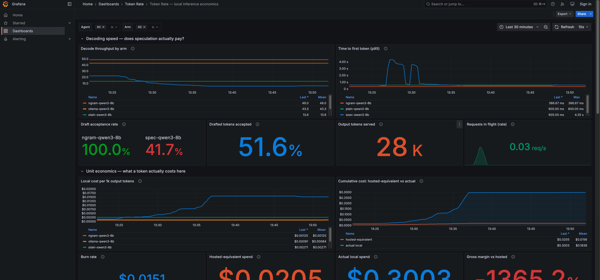

# Results: MacBook Pro M5 Pro, 48GB — 2026-10-15

A full run of this rig end to end on a second machine, moving from the
original M4 Air/16GB/Qwen3-8B baseline up to the M5 Pro/48GB/Qwen3-32B
profile. This doc is self-contained — read it top to bottom and you have
everything needed to reproduce, extend, or sanity-check the run without
digging through chat logs.

## Machine & profile

| | |
|---|---|
| Hardware | MacBook Pro, Apple M5 Pro, 48GB unified memory |
| Profile selected | `m5pro-48gb` (auto-detected from RAM — correct, no override needed) |
| Target model | Qwen3-32B-Q4_K_M (~19.8GB) |
| Draft model | Qwen3-1.7B-Q8_0 (~1.8GB) |
| Context | 32768 |
| `machine_cost_usd` | 3109.00 (≈ ₹3,00,000 at ~₹96.5/USD, 2026-10-15) |
| `load_watts` | **still the 45.0 placeholder — not yet measured** (see Outstanding below) |

Setup was `git clone` → `./scripts/bootstrap.sh` → done. One real hiccup:
Hugging Face's CDN dropped the resume on the 32B download once (file size
briefly went 8.4GB → 1.8GB mid-download), but the script's retry loop
recovered on its own with no manual intervention.

## Decode benchmark (`make bench`) — all three llama.cpp arms, same 32B weights

| arm | prompt type | tok/s (median) | out tok | local $/1k out | vs plain |
|---|---|---:|---:|---:|---:|
| plain (control) | generative | 13.7 | 328 | $0.00264 | — |
| plain (control) | structured | 13.4 | 364 | $0.00270 | — |
| plain (control) | extractive | 13.0 | 151 | $0.00277 | — |
| spec (draft-model) | generative | 17.1 | 345 | $0.00211 | +25% |
| spec (draft-model) | structured | 32.6 | 364 | $0.00111 | +144% |
| spec (draft-model) | extractive | 19.6 | 151 | $0.00185 | +50% |
| ngram | generative | 38.8 | 345 | $0.00093 | +184% |
| ngram | structured | 74.5 | 364 | $0.00048 | +457% |
| ngram | extractive | 64.0 | 151 | $0.00056 | +391% |

Raw data: `data/bench.json`.

**Draft acceptance (spec arm):** varies sharply by prompt — 47.5% (generative),
86.3% (structured), 49.5% (extractive). Weighted average **~62%**, still
comfortably above the repo's ~60% break-even line.

**Anomaly worth flagging, not yet explained:** the README's own prediction is
that n-gram speculation should be "near-useless on novel prose." Here it beat
draft-model speculation on *every single prompt type*, including generative
prose (38.8 vs 17.1 tok/s). That's the opposite of the expected shape and
deserves investigation before trusting the n-gram numbers for anything —
possibly a `--spec-draft-n-max`/`-p-min` tuning difference between arms, or a
genuine difference in how well n-gram vs draft-model speculation exploits this
particular 32B's repetition patterns.

**Invalid comparison in the bench table (not fixed, flagged only):** the
Ollama row is not apples-to-apples here. `config/models.yaml` hardcodes
Ollama to `qwen3:8b` regardless of the active profile, so on this 48GB
machine Ollama ran an **8B** model while the llama.cpp arms ran **32B**. The
repo's stated purpose for that row — isolating engine overhead from
speculation gains — does not hold on this profile. Left unfixed per
instructions not to touch `config/models.yaml`.

## Concurrency sweep (`make load`) — the batch ceiling

| concurrency | aggregate tok/s | p50 lat | p99 lat | $/1M tokens |
|---:|---:|---:|---:|---:|
| 1 | 17.4 | 4.1s | 33.1s | $2.08 |
| 2 | 17.0 | 5.3s | 34.4s | $2.12 |
| 4 | 25.4 | 10.1s | 68.5s | $1.42 |
| 8 | 23.2 | 23.5s | 72.0s | $1.56 |
| 16 | 24.4 | 75.0s | 136.2s | $1.48 |
| 32 | 25.9 | 162.3s | 233.2s | $1.40 |

Raw data: `data/load.json`.

The load generator's own script reports "ceiling = 32" because that's where
the raw tok/s number is numerically highest. **Don't trust that at face
value.** Aggregate throughput jumps ~1.5x going from concurrency 1 to 4
(matching llama-server's default `n_slots = 4`, confirmed in the spec arm's
startup log), then **flatlines in the 23–26 tok/s band all the way to 32** —
that spread is noise, not real scaling. Meanwhile p99 latency climbs
almost monotonically, 33s → 233s. Going from concurrency 4 to 32 buys
essentially zero extra throughput for 3.4x worse tail latency.

**The real, practical batch ceiling is 4** (the server's slot count), with a
floor price of **$1.42/1M tokens** there — nearly identical to the $1.40 the
script reports at 32, for a fraction of the wait. This is a *different shape*
than the M4 Air result (ceiling 2, throughput actually fell past it) but the
**same conclusion, reinforced**: llama.cpp's slot-based concurrency is not
continuous batching. Pushing concurrency past the slot count is pure latency
cost with no throughput reward, on both machines. The dashboard's
"Batching efficiency" panel independently confirms this — it reads ~0.97
(≈1.0 = no batching benefit) during load.

## 32B (M5 Pro) vs 8B (M4 Air) — does speculation help more on the dense model?

| | Qwen3-8B, M4 Air 16GB (idle) | Qwen3-32B, M5 Pro 48GB |
|---|---|---|
| plain decode | 20.8 tok/s | ~13.4 tok/s (avg across prompt types) |
| spec decode | 23.7 tok/s | ~23.1 tok/s (avg) |
| spec speedup vs plain | **+13.9%** | **+25% to +144%** depending on prompt |
| draft acceptance | 84.8% | ~62% (weighted avg) |
| spec $/1k output | $0.00067 | $0.00111–0.00211 |

Two findings, both pointing the same direction:

1. **Weight scaling vs memory bandwidth:** 4x the weights naively predicts
   ~5.2 tok/s on the same bandwidth (20.8 / 4). Actual plain decode on the
   32B is 13.4 tok/s — the M5 Pro's higher memory bandwidth more than
   doubles what the naive weight-scaling estimate would predict.
2. **Speculation helps substantially more on the dense 32B, confirming the
   bandwidth-bound hypothesis** — even with *lower* draft acceptance (62% vs
   84.8%). This makes sense: a 32B's decode step is dominated by reading 4x
   more weight bytes per token, so skipping full forward passes saves far
   more absolute wall-clock time per accepted draft token than on the
   already-fast 8B, even when a larger fraction of drafts get rejected.

## Incident: running Ollama alongside a llama.cpp arm crashed the GPU backend

Not just "slow" as the README warns for the 16GB profile — on 48GB it
actually corrupted the Metal backend. Querying `ollama-qwen3-8b` while the
`spec` arm (32B + 1.7B drafter, ~22GB) was resident loaded Ollama's 8B
(~9.9GB) into unified memory at the same time. Total pressure caused a
Metal `kIOGPUCommandBufferCallbackErrorOutOfMemory`, and the error is
**not self-healing** — `llama-server` logs "backend is in error state...
recreate the backend to recover" and every subsequent request 500s until the
process is restarted. Fix: stop the llama.cpp arm, force-unload Ollama's
model (`curl localhost:11434/api/generate -d '{"model":"qwen3:8b","keep_alive":0}'`),
then restart the arm. **Rule of thumb confirmed the hard way: never query
Ollama and a llama.cpp arm in the same window, even on 48GB.**

## Bug found and fixed: two Grafana panels showed "No data"

`monitoring/grafana/dashboards/token-rate.json` panels 23 ("Cost per 1M
output tokens") and 25 ("Batching efficiency") divided a label-stripped
`sum(...)` by a vector that still carried `{instance, job, service}` labels.
Prometheus's default vector matching requires identical label sets on both
sides of a binary op, so the division silently returned nothing — not the
`rate()`-on-a-single-sample gotcha the README calls out, a different, genuine
query bug. Fixed by wrapping the other side in `sum()` too (commit `4bb96ef`).
Confirmed both panels return data after a Grafana container restart.



## Outstanding — pick up here next session

- [ ] **`load_watts` is still the 45.0 placeholder.** Never measured because
      it needs an interactive `sudo` password this session couldn't supply.
      Thirty-second job: `./scripts/serve.sh plain`, fire a long generation,
      then `sudo powermetrics --samplers cpu_power -i 1000 -n 35` yourself
      while it's decoding. Every local cost figure above is only as correct
      as this one number.
- [ ] Stripe test-mode billing (`make stripe-setup` → `make load-at N=8` →
      compare `make stripe-usage` vs `make usage`) — never started, needs a
      `sk_test_` key.
- [ ] The ngram-beats-spec anomaly above is unexplained and worth a second
      look before quoting the ngram numbers anywhere that matters.
- [ ] Models were deleted after this run to reclaim ~22GB of disk
      (`rm -rf models/`). Re-run `./scripts/fetch_models.sh` before starting
      any arm again.

## Reproducing this run

```bash
cd token-rate
./scripts/fetch_models.sh      # models were removed after this run
./scripts/serve.sh spec        # or ngram / plain
make proxy                     # separate shell
make monitoring-docker         # Grafana :3001, Prometheus :9090
make bench                     # ~15-20 min on the 32B
make load                      # concurrency sweep, ~10-15 min
```

Dashboard: http://127.0.0.1:3001/d/token-rate-main — set the time range to
match your run (the screenshot above used "Last 30 minutes").
